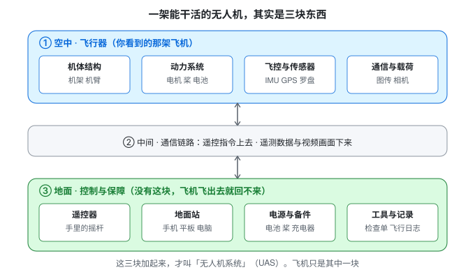
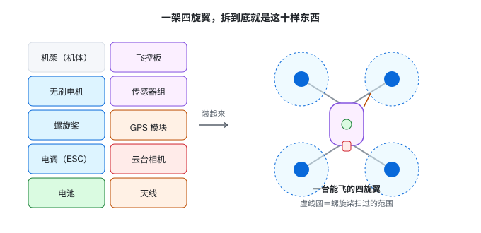
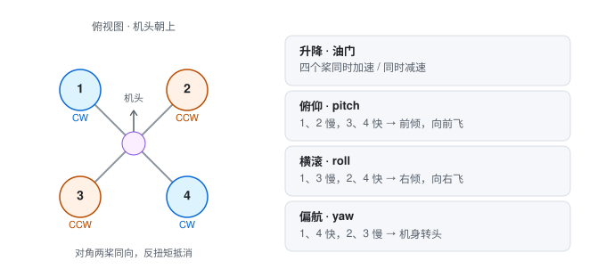
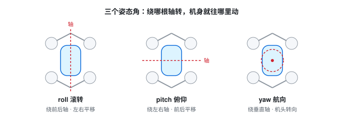
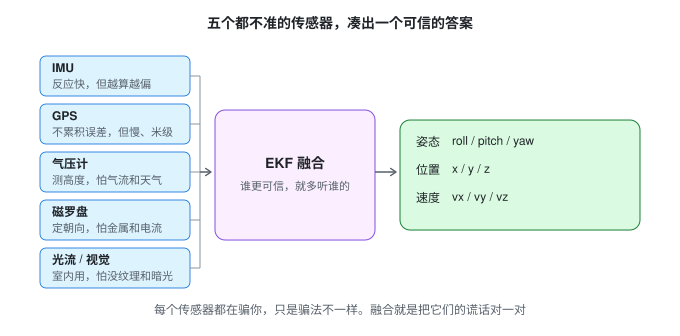
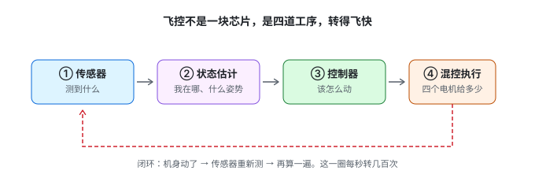
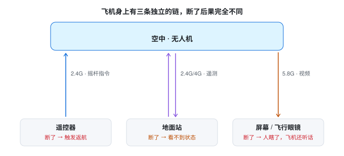

# 从零认识无人机

> 这份文档写给**完全没接触过无人机的人**。不需要航空背景，不需要电子基础，会上网就行。
>
> 读完你会知道：无人机是什么、由哪些部分拼起来、为什么能飞、怎么知道自己在哪里、怎么听人指挥、断联了会怎样。**读完大约 2 小时，动手查资料的话 4 小时。**
>
> 全程 7 张图，都在 [`figures/`](figures/) 目录下。用 VS Code 打开本文件按 `Cmd+Shift+V`（Windows 是 `Ctrl+Shift+V`）就能边读边看图，不用装插件。

**怎么读**：**先看图，再看字。** 每一节都是图打头。图看不懂就先只看图下面的说明，回头再读文字。每节结尾有三个小问题，答不出来就回上一节——后面的内容全建立在前面的概念上。

---

## 00 先看一张图：无人机不是"一架飞机"



大多数人对无人机的印象，就是天上那架嗡嗡响的小飞机。

但一架真正能干活的无人机，是**三块东西**凑起来的：

**上面那块 · 飞行器。** 就是你看到的那架飞机。机架撑着、电机带着桨转、飞控在中间算、传感器到处看。这块是"**手和脚**"。

**中间那条 · 通信链路。** 你看不见它，但它断了立刻出事。你的摇杆动作靠它传上去，飞机的状态和画面靠它传下来。这块是"**神经**"。

**下面那块 · 地面设备。** 遥控器、手机或平板上的地面站软件、备用电池、检查单、飞行日志。**很多人完全不知道这块的存在**——但没有它，飞机飞出去就回不来，因为你不知道该往哪飞，也看不见它在干什么。这块是"**眼睛和一部分大脑**"。

所以行业里有个更准确的说法：**无人机系统**（UAS，Unmanned Aircraft System）。"系统"两个字不是摆设，是在提醒你：**只盯着飞机看，就会漏掉一半的问题。**

> **一个真实的比例**：工业级无人机项目里，飞机本身通常只占整套投入的一半左右，剩下的在地面站、链路、备件和人员培训上。**出故障的时候，一半的问题不在天上，在地上。**

接下来每一节，都是把这张图里的某一块拆开放大看。

---

## 01 无人机到底是什么

### 一句话定义

**无人机 = 没有人坐在里面的飞行器。**

就这么简单。它不等于"四旋翼"，不等于"航拍机"，也不等于"玩具"。

它的学名叫**无人驾驶航空器**，整套系统叫**无人机系统**（UAS）。三个词快速分清：

- **UAV**：只指那架飞机本身
- **UAS**：飞机 + 链路 + 地面设备，也就是上一节那张图的全貌。**面试时说"无人机系统"比说"无人机"专业一档**
- **Drone**：口语，原意"雄蜂"（飞起来声音像），技术上不严谨

日常说"无人机"，通常指 UAS。

### 三个必须打破的误解

**误解一：无人机就是四旋翼。**  
不对。四旋翼只是**多旋翼**里最常见的一种。还有固定翼（像模型飞机，靠机翼产生升力）、无人直升机（顶上一个大会转的桨）、复合翼（起飞时像多旋翼，巡航时像固定翼）。**它们的飞法、用途、测试重点完全不同**，后面会讲。

**误解二：无人机就是拿来拍照的。**  
航拍只是消费级市场。工业上，无人机在巡检电塔、喷洒农药、测绘地形、送快递、救火、搜救、抓"黑飞"。**这些才是无人机行业的主要收入来源**，也是招聘岗位最集中的地方。

**误解三：无人机很简单，就是个会飞的相机。**  
它同时在做四件很难的事：**在晃动的环境里知道自己在哪里**（定位）、**在风里保持姿势**（控制）、**把画面实时传回来**（通信）、**在电量耗尽前安全落地**（能源管理）。任何一件出错，结果都是摔机。

### 按构型分：四种主流形态

| 构型                | 怎么飞起来              | 优点               | 缺点                         | 常见用途        |
| ----------------- | ------------------ | ---------------- | -------------------------- | ----------- |
| **多旋翼**（4/6/8 个桨） | 螺旋桨往下吹，靠反作用力把机身顶起来 | 能悬停、能垂直起降、结构简单   | 飞不久（一般 20-40 分钟）、飞不快、载不了太重 | 航拍、巡检、植保、物流 |
| **固定翼**           | 靠机翼在前进时产生升力        | 飞得久（小时级）、飞得远、载重大 | **不能悬停**，需要跑道或弹射起飞         | 测绘、大面积巡线    |
| **无人直升机**         | 主旋翼变桨距             | 载重大、抗风强          | 机械复杂、贵、危险                  | 重载运输、农业     |
| **复合翼**（垂直起降固定翼）  | 起飞用多旋翼，巡航用固定翼      | 兼得两者             | 结构复杂，**模式转换那几秒最容易出事**      | 电力巡线、海事、应急  |

> **给新手一个记忆法**：多旋翼像"直升机的小孩"，能停在空中；固定翼像"纸飞机"，必须一直往前飞才不落。

### 为什么这几年才普及

不是新发明——无人机概念有一百多年了。真正爆发是因为**三样东西同时变便宜了**：

1. **锂电池**：能量密度上来了，才能带得动 + 飞得久
2. **无刷电机 + 电子调速器**：便宜、可靠、功率大
3. **MEMS 传感器 + 便宜算力**：指甲盖大的芯片能测加速度和角速度，手机芯片能跑控制算法

**所以无人机本质上是"消费电子品的胜利"**，不是航空工业的胜利。理解这一点，你就理解了为什么行业里一半的人是从手机、汽车电子、通信行业转过来的。

### 本节三问

1. UAV 和 UAS 差什么？
2. 固定翼最大的局限是什么？为什么？
3. 无人机这几年变便宜，靠的是哪三样东西？

---

## 02 拆开看：一架无人机由什么组成



图里十样东西，可以归成五个系统。**记住五个系统比记住十个零件有用**，因为出故障时你按系统排查。

### 一、骨架：机架

**是什么**：机身和机臂，把所有东西固定在一起的那副"骨架"。常见材质是碳纤维（轻、硬）或工程塑料。

**关键参数**：**轴距**——对角两个电机之间的距离，单位毫米。轴距 350mm 是小型机，900mm 以上就是大机器了。

**坏了会怎样**：机臂裂纹不会立刻让你摔，但会在飞行中引起异常振动，**振动会让传感器数据变脏，进而让飞机"发神经"**。所以每次飞完检查机臂是标准动作。

### 二、动力：电机、电调、螺旋桨、电池

这是无人机的"心脏和肌肉"，四个零件缺一不可。

**① 无刷电机**

- 就是让桨转起来的马达。之所以叫"无刷"，是因为它不用碳刷接触导电，靠电子换向，所以寿命长、效率高。
- **关键参数 KV 值**：每伏特电压对应的空载转速。**KV 越低扭矩越大、配大桨；KV 越高转速越快、配小桨。**
- 常见错误理解：KV 高不代表"更有劲"，只代表"转得更快"。选错 KV 配错桨，电机烫到能煎蛋。

**② 电调（ESC，Electronic Speed Controller）**

- 飞控只会"发号施令"，真正给电机供电、控制转速的是电调。**一个电机配一个电调**。
- 它接收的信号常见两种：PWM（老式，一根线传一个通道）和 DShot（数字式，抗干扰好、响应快）。

**③ 螺旋桨**

- 两个关键数字，比如 **9450**：前面两位是直径（9 英寸），后面两位是螺距（4.5 英寸）。螺距越大，每转"咬"的空气越多，推力越大，但也越费电。
- **桨有正反之分**（CW 顺时针 / CCW 逆时针），装反了飞机原地打转或直接翻。

**④ 电池**

- 主流是锂聚合物（LiPo）。**单片电芯标称 3.7V，充满 4.2V，用到 3.5V 就该落地了。**
- 常说的 "4S" 就是 4 片串联，标称 14.8V。
- **mAh** 是容量，**C 数**是放电倍率（能多大电流放电）。C 数不够，猛推油门时电压会瞬间塌下去。
- **最大的敌人是低温和内阻**：冬天续航掉三成是常态，不是电池坏了。

> **动力系统的核心概念：推重比**  
> = 最大总推力 ÷ 起飞重量。多旋翼一般在 **2:1** 左右，意思是"能吊起自己两倍的重量"。  
> **低于 1.5 的机器，抗风和高原性能一定差**——因为它没有余量去对抗外力。这是看参数时最该注意的一个比值。

### 三、大脑：飞控

**是什么**：一块电路板，上面跑着控制程序。它每秒要做几百次判断："我现在什么姿势？该用什么力度？"

**它自己带了一堆传感器**（叫 IMU，惯性测量单元）：

- **加速度计**：感受"往哪个方向被推"
- **陀螺仪**：感受"转得多快"

**飞控还管着另外几件事**：解析遥控信号、执行飞行模式、监控电池、触发失控保护。**它是整台飞机唯一有"决策权"的东西。**

**坏了会怎样**：飞控死机 = 飞机变成一块砖。所以正规设计都有"看门狗"（Watchdog）——主程序卡住时自动重启或强制降落。

### 四、感官：GPS、气压计、磁罗盘、光流

飞控需要知道"我在哪、多高、朝哪边"，这些靠外面的传感器：

| 传感器         | 测什么     | 通俗类比              | 会怎么骗人                    |
| ----------- | ------- | ----------------- | ------------------------ |
| **GPS**     | 经纬度、速度  | **看地图**           | 精度只有米级，会慢慢漂；被楼挡住就没信号     |
| **气压计**     | 气压 → 高度 | **感觉耳朵闷不闷**       | 螺旋桨的风、天气变化都会影响，悬停时会缓慢上下漂 |
| **磁罗盘**     | 地磁 → 朝向 | **指南针**           | 旁边有金属、电流、钢筋就会指错          |
| **光流 / 视觉** | 相对地面的移动 | **看地板纹理判断自己在不在动** | 地面纯色、水面、太暗就不管用           |

> **一个必须知道的常识**：普通 GPS 水平精度约 **1-3 米**。所以"悬停时飞机慢慢漂了半米"是**正常物理现象**，不是故障。要厘米级必须上 **RTK**（加一个地面基站做差分修正）。

### 五、通信与载荷：天线、图传、云台相机

- **天线**：分遥控天线、图传天线、GPS 天线，各管各的，位置不能随便改。
- **图传**：把摄像头画面实时传回地面，见第 06 节。
- **云台相机**：云台是"防抖支架"，用三个电机抵消机身晃动，让画面稳。**云台和相机是两回事**，云台坏了画面会跟着飞机一起抖。

### 关键参数速查

看到一张无人机参数表，先找这六个：

| 参数   | 意思         | 怎么判断好坏                      |
| ---- | ---------- | --------------------------- |
| 轴距   | 对角电机距离     | 越大越稳、载重越大、越不灵活              |
| 起飞重量 | 含电池的实际重量   | 一切性能指标的分母                   |
| 最大载重 | 能额外带多少     | 载重一上去，续航抗风全线下降              |
| 续航   | 悬停时间       | 标称 30 分钟，实际有风、有载重会明显缩水      |
| 抗风等级 | 能抗几级风      | **要问清是"能飞"还是"能保持精度"**       |
| 防护等级 | IP 后面的两位数字 | IP43 是防淋雨，IP55 是防喷水，都不是防水浸泡 |

### 本节三问

1. 电调和电机分别干什么？为什么一个电机要配一个电调？
2. 推重比 1.2 的机器会有什么问题？
3. 悬停时高度缓慢下降 0.5 米，最可能是什么传感器的问题？

---

## 03 它为什么能飞

### 先理解升力

螺旋桨转起来，把空气**往下推**。空气不甘心被推，就**反过来把飞机往上顶**。这是牛顿第三定律（作用力与反作用力）。

所以：

> **推力 ∝ 转速的平方**

意思是转速变成 2 倍，推力变成 4 倍。这个非线性关系很重要——它解释了为什么**油门推到一半时感觉"没劲"，过了一半突然"窜起来"**。

### 一台四旋翼只有一种手段：转速

这是最反直觉、也最该记住的一点：**四个电机，只能调转速，但要完成四个动作。**



- **升降**：四个桨同时加速（往上）或同时减速（往下）
- **俯仰（pitch）**：前面两个慢、后面两个快 → 机身前倾 → 向前飞
- **横滚（roll）**：左边两个慢、右边两个快 → 机身右倾 → 向右飞
- **偏航（yaw）**：对角两个快、另两个慢 → 机身转头

**为什么偏航这么特殊？**

螺旋桨转动时，空气会给它一个**反作用扭矩**（就像你拧螺丝，螺丝刀会反着拧你手）。正常情况下，对角两个桨正转、另两个反转，**反扭矩正好互相抵消**。要让机身转头，就**故意打破这个平衡**——让同方向转的两个桨转快一点。

代价是：**偏航时总推力会轻微变化**。这是四旋翼的固有缺陷，也是"定点悬停时航向慢慢偏"的原因之一。

### 三个姿态角



| 名字        | 中文 | 绕哪根轴         | 结果        |
| --------- | -- | ------------ | --------- |
| **roll**  | 滚转 | 前后轴（像人往左右歪头） | 左右平移      |
| **pitch** | 俯仰 | 左右轴（像点头）     | 前后平移      |
| **yaw**   | 航向 | 垂直轴（像原地转身）   | 机头转向，位置不变 |

这三个角合起来叫**姿态**。姿态稳，飞机才稳。

### 关键认知：没有人直接控制位置

这是整篇文档最重要的一句话：

> **飞控从来没有"往右飞"这个指令，它只有"把机身向右倾斜 5 度"这个动作。位置，是姿态和推力算出来的结果。**

所以当飞机"位置不准"时，一定要往上游找：

1. **是姿势没摆对吗？**（控制问题）
2. **是姿势对了但推力不够吗？**（动力问题）
3. **是它以为自己摆对了，其实没有？**（估计问题）

**能问出这三句的人，和只会说"它飞歪了"的人，是两种水平。**


### 那悬停为什么会飘？

三层原因，缺一层都不完整：

| 层       | 原因              | 具体表现                        |
| ------- | --------------- | --------------------------- |
| **估计层** | 飞控以为自己在 A，实际在 B | GPS 精度不够、磁干扰、气压计受风影响        |
| **控制层** | 知道偏了，但修不过来      | 参数不合适、响应有延迟、电机已达最大转速        |
| **扰动层** | 外面有东西在推它        | 风、地效（贴近地面时的气流反弹）、楼间乱流、载重偏一边 |

**记住这个三层结构**，以后不管遇到什么"飞不稳"，你都有一条完整的排查路径。

### 本节三问

1. 转 2 倍，推力变几倍？
2. 为什么偏航会让总推力变化？
3. 悬停时飞机慢慢往东南漂，三层原因各举一个具体例子。

---

## 04 它怎么知道自己在哪



先记住图上这一句话：**没有一个传感器是准的**，它们只是"错的方式不一样"。飞控要做的事，就是把五份都不准的报告，对成一个能用的结论。

为了好记，再把无人机想象成一个人。人靠五官感知世界，它靠传感器：

| 人       | 无人机             | 干什么             |
| ------- | --------------- | --------------- |
| 内耳（平衡感） | IMU（加速度计 + 陀螺仪） | 感觉自己在不在转、在不在加速  |
| 眼睛      | 相机 / 光流 / 视觉传感器 | 看周围和地面，判断有没有在移动 |
| 看地图认路   | GPS             | 知道自己的经纬度        |
| 感觉耳朵闷   | 气压计             | 判断高度变化          |
| 带指南针    | 磁罗盘             | 知道朝向            |

### 为什么需要"融合"

如果每个传感器都很准，直接用一个就行了。问题是**每个都不准，而且错的方式不一样**：

- **IMU 反应快**（每秒几百次），但会**越算越偏**（误差累积）
- **GPS 不累积误差**，但**更新慢**（每秒几次），而且精度只有米级
- **气压计**能测高度，但**受风和天气影响**
- **磁罗盘**能定朝向，但**旁边有金属就废**

解决方案叫 **数据融合**，用的是**卡尔曼滤波**（具体实现叫 **EKF**，扩展卡尔曼滤波）。它的核心思想用一句话讲：

> **两个都不准的尺子，互相校一校，比任何一把都可靠。谁更可信，就多听谁的。**

那个"有多可信"，数学上叫**协方差**。你不用会算，只要理解"它在动态调整对每个传感器的信任度"就够。

### 三种典型失效（记住现象就够了）

1. **磁干扰**：起飞前靠近了铁栏杆、车里、钢筋楼 → 磁罗盘指错 → **起飞就往一边偏/原地打转**
2. **GPS 跳变**：楼间、桥下、树林 → 位置数据突然跳到几十米外 → **飞机猛地窜一下**
3. **振动过大**：桨不平衡、机臂松动 → IMU 数据全是噪声 → **姿态估计崩了 → 飞机剧烈抖动甚至翻转**

> 这三个现象你都可能亲眼见到。**能说出"这是振动引起的估计失效"而不是"飞机坏了"，就是入门和没入门的区别。**

### 本节三问

1. 为什么不能只靠 GPS 悬停？
2. 起飞就原地打转，最可能是什么问题？
3. "融合"到底在解决什么问题？

---

## 05 它怎么听懂人话

飞控不是一块"聪明的芯片"，它是**四道工序连成的一条流水线，转得飞快**。



| 工序     | 在干什么               | 通俗说法      |
| ------ | ------------------ | --------- |
| ① 传感器  | 采集原始数据             | 「我感觉到了什么」 |
| ② 状态估计 | 融合出"我在哪、什么姿势、速度多少" | 「我在哪」     |
| ③ 控制器  | 对比目标，算出该怎么动        | 「我该怎么动」   |
| ④ 混控执行 | 转换成四个电机各自的推力       | 「每个电机给多少」 |

**为什么第③步要"套娃"（串级）？**

因为"往右飞 2 米"这件事太大，一次算不准。所以拆成四小步：

```
位置环：我离目标还差多远  →  该用多快的速度过去
速度环：我现在的速度够不够  →  该用多大的加速度
姿态环：要多大的加速度，机身得倾斜多少度  →  该用多快的角速度转
角速率环：每秒转多少度，四个电机怎么分配
```

**里层必须比外层反应快 5-10 倍**，否则整个系统会打架、发抖。

### 飞行模式：飞控替你做了多少事

这是新手最容易搞混的地方。**同一个摇杆动作，在不同模式下结果完全不同。**

| 模式                 | 飞控管什么        | 你还要管什么        | 适合谁     |
| ------------------ | ------------ | ------------- | ------- |
| **手动 / 自稳**        | 只帮你稳住姿态      | 高度、前后左右全靠手    | 老手、飞穿越机 |
| **定高**             | 姿态 + 高度      | 水平位置靠手        | 新手练习    |
| **定点（GPS）**        | 姿态 + 高度 + 位置 | 只用摇杆给"往哪走"的指令 | **最常用** |
| **航线 / 任务**        | 全接管，按预设航点飞   | 只负责监控         | 测绘、巡检   |
| **外部控制（Offboard）** | 听电脑的指令       | 什么都不管（程序管）    | 自动化飞行   |
| **自动返航**           | 全接管，飞回起飞点    | 只监控           | 失控时     |

> **"定点"和"定高"差一个字，安全性差很多。** 定高模式下你不推方向杆，它会随风慢慢飘走；定点模式会自己顶住风。

### 断联了会怎样：失控保护

飞控里有一套"最后一层保险"，叫 **failsafe**（失效保护）：

| 什么断了      | 通常怎么办                  |
| --------- | ---------------------- |
| 遥控信号丢失    | 原地悬停等待几秒 → 超时自动返航（或降落） |
| 电池电量过低    | 先告警，然后强制自动返航           |
| GPS 丢失    | 降级到定高模式，漂着等你接管         |
| 飞出电子围栏    | 停止前进 / 自动刹停            |
| 外部控制程序无响应 | 切回自主模式或降落              |

**这套保护做得好不好，直接决定这台机器能不能商用。** 所以正规公司会专门测它——故意拔电池、故意关遥控、故意断网，看它是不是真能安全回来。

### 本节三问

1. 四道工序分别是什么？
2. 定高模式和定点模式的区别？
3. 关掉遥控器，飞机会做什么？

---

## 06 三条看不见的链

飞机和地面之间，其实有**三条各自独立的通信链**，各管一件事。



| 链       | 传什么               | 常见频段             | 断了会怎样                          |
| ------- | ----------------- | ---------------- | ------------------------------ |
| **遥控链** | 你的摇杆动作            | 2.4G / 900M      | **触发返航保护**（因为它断了飞控就知道"人找不到我了"） |
| **数传链** | 飞机的状态数据（遥测）+ 地面指令 | 2.4G / 4G        | 地面站看不到状态，但飞机可能继续飞              |
| **图传链** | 摄像头画面             | 5.8G / 2.4G / 4G | **飞手"瞎了"，但飞机还听话**              |

> **最危险的不是遥控断，是图传断。** 遥控断会触发保护机制，飞行器自己会返航；图传断没有任何保护会启动，但人失去了判断依据——**看不见画面的人，容易乱操作**。这是"人因失效"，也是专业测试必须覆盖的场景。

### 影响信号的几个常识

- **遮挡**：信号不是"直线能看见就行"，它需要一定空间通过。所以**贴着地面飞、楼间飞，比高空飞容易断**。
- **同频干扰**：2.4G 是最挤的频段（WiFi、蓝牙都在这儿）。
- **天线方向**：天线没立起来、被机身挡住，信号差很多。
- **水面/玻璃反射**：信号经过反射会产生"多路径"，导致忽强忽弱。

### 本节三问

1. 三条链各传什么？
2. 为什么说"图传断"比"遥控断"更危险？
3. 为什么贴地飞更容易断链？

---

## 07 一台飞机怎么从零件变成能飞

知道组成之后，再看装配顺序就顺了。**顺序错了会烧东西**（比如先接电后接电机）。

大致的装配顺序：

1. **机架** → 骨架立起来
2. **电机** → 装到机臂上（注意转向是交替的）
3. **电调** → 焊到分电板 / 接到飞控
4. **飞控** → 固定在机身中心（必须有减震，否则振动会毁了传感器）
5. **接收机 + 天线** → 遥控、图传、GPS 各就各位
6. **GPS + 磁罗盘** → **必须远离电源线**，否则被干扰
7. **云台相机** → 挂到机腹，注意不要挡住下视传感器
8. **电池** → 最后装，装机前先确认正负极
9. **上电 + 校准** → 加速度计校准、磁罗盘校准（必须在空旷无磁环境）
10. **参数配置** → 机型、电调协议、失控保护动作、围栏
11. **地面测试** → 拆桨通电，检查转向和响应
12. **首次飞行** → 空旷场地，低高度短时间

> **第 11 步"拆桨测试"是铁律**：装桨之前先通电检查，可以避免一批血案。

### 每次起飞前的检查单

专业的飞行前检查是固定动作，不是凭记忆：

- 空域是否允许（有没有报备、是不是禁飞区）
- 天气（风速、阵风、降水、能见度、温度）
- 电量（遥控器 + 飞机 + 手机/平板）
- 桨叶（有无裂纹、是否装反）
- 结构（机臂、螺丝、云台）
- 传感器状态（卫星数、指南针是否正常）
- 应急预案（失控往哪落、人群在哪）

---

## 08 无人机在干什么活

**场景决定机型，机型决定测试重点。** 这张表是"行业地图"：

| 场景            | 常用机型       | 关键要求        | 最难的地方             |
| ------------- | ---------- | ----------- | ----------------- |
| **航拍 / 影视**   | 小型多旋翼      | 画面稳、云台好     | 复杂环境避障、跟拍精度       |
| **电力 / 油气巡检** | 中型多旋翼、复合翼  | 长续航、抗风、热成像  | 强电磁干扰、贴塔飞行的安全性    |
| **测绘 / 三维建模** | 固定翼、复合翼    | 定位精度（要 RTK） | 航线规划、成图精度         |
| **农林植保**      | 大型多旋翼      | 载重、喷洒均匀     | 药液腐蚀、低空作业、地形跟随    |
| **物流配送**      | 多旋翼 + 机场   | 可靠性、自动化     | 末端投放精度、全程无人值守     |
| **应急救援**      | 多旋翼、复合翼    | 快速部署、夜间能力   | 复杂气象、通信中断         |
| **安防 / 反制**   | 多旋翼 + 探测设备 | 长时间值守       | 目标识别、协同           |
| **表演编队**      | 小型多旋翼      | **批量一致性**   | 几百台同时飞，单台失效就是演出事故 |

> **行业里最缺人的地方**：不是航拍，是**巡检、测绘、机场运维**。因为这些岗位要求"既懂飞行又懂业务还要能出报告"，而单纯会飞的人不做报告，会做报告的人不懂飞行。

---

## 09 三十个术语速查

看资料遇到不认识的词，回来查这里。

| 术语              | 意思                       |
| --------------- | ------------------------ |
| **轴距**          | 对角两个电机的距离，衡量机身大小         |
| **KV 值**        | 电机每伏特电压对应的空转转速           |
| **电调 / ESC**    | 给电机供电并控制转速的电子部件          |
| **桨距**          | 螺旋桨转一圈前进的理论距离            |
| **CW / CCW**    | 顺时针 / 逆时针（桨的转向）          |
| **推重比**         | 最大推力 ÷ 起飞重量，多旋翼约 2:1     |
| **飞控**          | 飞行控制器，飞机的"大脑"            |
| **IMU**         | 惯性测量单元，含加速度计和陀螺仪         |
| **EKF**         | 扩展卡尔曼滤波，多传感器数据融合算法       |
| **气压计**         | 测气压换算高度，会受风影响            |
| **磁罗盘**         | 电子指南针，怕金属和电流             |
| **光流**          | 用摄像头看地面纹理判断移动，室内定位靠它     |
| **RTK**         | 实时动态差分定位，精度到厘米级，需要地面基站   |
| **遥控 / RC**     | 你手里的遥控器和它的链路             |
| **数传**          | 传遥测数据和指令的链路              |
| **图传**          | 传视频画面的链路                 |
| **MAVLink**     | 无人机和地面站之间的通信协议           |
| **地面站 / GCS**   | 地面上的软件，看状态、发指令、规划航线      |
| **航点 / 航线**     | 预设的坐标点和连接它们的路径           |
| **定点 / 悬停**     | 飞控自动保持位置不动的状态            |
| **姿态**          | 机身的倾斜和朝向（roll/pitch/yaw） |
| **姿态角速率**       | 每秒转多少度，最内层的控制量           |
| **串级控制**        | 位置→速度→姿态→角速率，一层套一层       |
| **PID**         | 最常用的控制算法，P 比例、I 积分、D 微分  |
| **混控**          | 把控制量分配成每个电机具体的推力         |
| **Offboard**    | 由外部计算机控制的模式，自动化测试常用      |
| **Failsafe**    | 失效保护，断联/低电时的自动动作         |
| **电子围栏 / 地理围栏** | 设定的禁止飞行区域                |
| **载荷**          | 无人机带的任务设备（相机、喷洒、喊话器）     |
| **SIL / HIL**   | 软件在环 / 硬件在环，仿真测试的两种级别    |
| **ULog**        | PX4 飞控的飞行日志格式            |
| **AOPA / CAAC** | 无人机驾驶员相关资质与民航局           |
| **真高**          | 相对正下方地面的高度（不是海拔）         |

---

## 10 十个最常见的误解

新手一定会踩这十个坑。看到有人说这些话，你就知道他还停在入门之前。

**1. "有 GPS，悬停就该纹丝不动。"**
→ 普通 GPS 的水平精度只有 1-3 米，它本来就一直在轻微漂。想让飞机钉在一个点上，得上 RTK（厘米级）或者视觉定位。

**2. "标称续航 30 分钟，就能飞 30 分钟。"**
→ 那个 30 分钟通常是空载、无风、匀速悬停测出来的。带上负载、遇上风、天冷电池蔫，实际能飞 20 分钟就算好。

**3. "图传说 10 公里，就能飞 10 公里远。"**
→ 那是最理想条件下的极限值，实验室数据。城市里楼一挡、天线一歪，打对折都算正常。

**4. "摔一下没事，捡起来接着飞。"**
→ 表面看着没事，机臂里可能已经有细裂纹。裂纹会引起振动，振动会让传感器数据变脏，飞机就开始"发神经"。**摔过的机器必须重新检查。**

**5. "今天风不大，能飞。"**
→ 要分清"能飞"和"能干活"。做巡检、测绘时，风只要让定位精度掉下来，任务就已经失败了——虽然飞机还好好的。

**6. "遥控器一断，飞机就掉下来。"**
→ 正常设计会触发失控保护：先原地悬停等你几秒，等不到就自动返航或降落。**"一断就掉"是缺陷，不是常态。**

**7. "电用到 0 也没事，有保护。"**
→ 锂电池过放会永久损坏，而且电压塌下去的那一刻，飞控可能已经来不及返航了。**留 30% 落地是常识，不是胆小。**

**8. "四旋翼比固定翼落后。"**
→ 不是先进落后，是**取舍不同**。多旋翼用续航换来了"能悬停"，固定翼用"不能停"换来了"飞得久"。选哪个看任务。

**9. "室内飞更安全，因为没风。"**
→ 室内没有 GPS，只能靠光流和气压计，这两个都是"相对测量"，误差会越积越多。**室内其实更容易漂，而且空间小、撞上就是事故。**

**10. "无人机就是个会飞的相机。"**
→ 它同时在做四件难事：**知道自己在哪**、**在风里稳住**、**把画面传回来**、**在没电前安全落地**。任何一件出错，结果都是摔机。

---

## 11 自测 20 题

先自己答，答完再展开看答案。**能答对 15 题以上，你就完成了入门。**

1. UAV 和 UAS 的区别是什么？
2. 多旋翼和固定翼最本质的区别？
3. 一台四旋翼要做"向右平移"，四个电机分别怎么变？
4. 为什么偏航会让总推力变化？
5. roll、pitch、yaw 分别绕哪根轴？
6. 转 2 倍，推力变几倍？
7. 推重比 1.2 意味着什么？
8. 电调和电机分别干什么？
9. 螺旋桨型号 9450 是什么意思？
10. 4S 电池的标称电压是多少？
11. 为什么悬停时高度会慢慢变？
12. GPS 的水平精度大概是多少？
13. 起飞就原地打转，最可能是什么问题？
14. 飞控的四道工序是什么？
15. 定高和定点模式的区别？
16. 关掉遥控器，飞机会做什么？
17. 三条通信链分别是什么？断哪条最危险？为什么？
18. 室内飞行为什么更容易漂？
19. 为什么机臂有裂纹很危险？
20. 无人机上电后第一件事为什么要"拆桨测试"？

<details>

<summary>点开看答案</summary>

1. UAV 只指飞机本身；UAS 是整套系统，含飞机、地面站、通信链路。
2. 多旋翼靠推力直接对抗重力、能悬停；固定翼靠前进时空气流过机翼产生升力、不能悬停。
3. 左边两个桨（左前、左后）减速，右边两个桨（右前、右后）加速。
4. 偏航靠打破对角桨的反扭矩平衡实现，平衡一破，总推力也随之改变。
5. roll 绕前后轴，pitch 绕左右轴，yaw 绕垂直轴。
6. 4 倍（推力与转速的平方成正比）。
7. 最大推力只有自重的 1.2 倍，几乎没有余量，抗风和高原性能会很差。
8. 电调负责给电机供电并控制转速；电机负责转。一个电机配一个电调。
9. 直径 9 英寸，螺距 4.5 英寸。
10. 14.8V（单片 3.7V × 4）。
11. 气压计受螺旋桨气流、天气变化影响，测出来的高度在缓慢变化；IMU 长期还会累积漂移。
12. 约 1-3 米（普通单点 GPS，无 RTK）。
13. 磁罗盘受干扰或未校准，航向估计错误。
14. 传感器采集 → 状态估计 → 控制器计算 → 混控执行。
15. 定高只管高度，水平位置会随风漂走；定点连水平位置也自动保持。
16. 通常先原地悬停等待几秒，超时后自动返航（或降落）。
17. 遥控链、数传链、图传链。图传断最危险——它不触发保护，但人失去视觉判断，容易误操作。
18. 室内没有 GPS，只能靠光流和气压计，两者都是相对测量，误差会累积。
19. 机臂裂纹会引起异常振动，振动会让 IMU 数据失真，导致姿态估计出错，飞机可能失控。
20. 拆掉桨通电，可以在不伤人的前提下检查电机转向和响应是否正确。

</details>

---

## 12 接下来学什么

读完这份，你已经有了"整机地图"。往下走三条路，看你兴趣：

**想动手飞** → 买个入门机或模拟器，先把"定点悬停"练稳。手感这东西只能靠时间。

**想懂原理** → 从飞控入手：PX4 或 ArduPilot 的官方文档，配合仿真环境（SITL），能在电脑上把飞机"飞"起来。推荐路径见 [pytest 飞行回归测试](../pytest-飞行回归测试.md) 和 [自动化飞行测试流水线](../自动化飞行测试流水线.md)。

**想做测试 / 工程** → 学"把飞行变成数据"：怎么看日志、怎么定判据、怎么出报告。本仓库的 [`ulog-判读.md`](../ulog-判读.md) 就是这块的实操。

> **最后一句**：无人机这个领域，**背书不如装机，装机不如飞，飞不如把每次飞行变成可复现的数据**。你现在读的这份文档，是让你在"装机"和"飞"的时候，知道自己在看什么。

---

## 参考资料

- PX4 官方文档：<https://docs.px4.io>（飞行模式、EKF2、日志分析三页最有价值）
- PX4 Flight Review：<https://review.px4.io>（上传日志自动出图）
- 《无人驾驶航空器飞行管理暂行条例》（2024 年 1 月 1 日施行）
- 中国民航局 UOM 系统：<https://uom.caac.gov.cn>（实名登记、空域查询）

---

*文档版本 2026-11-07 初稿。图在 `figures/` 目录，纯 SVG，可直接编辑。*
